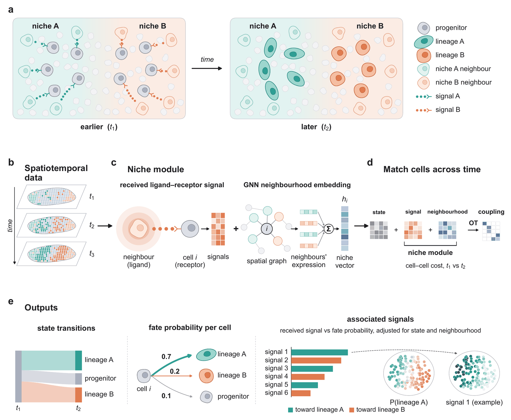

# Niche-FATE

Niche-aware inference of cell-state transitions from spatiotemporal data.

Niche-FATE takes spatial transcriptomics data sampled at two or more time points. It matches cells across time points by optimal transport, using each cell's gene expression together with its niche: the ligand–receptor signals it receives and an embedding of its spatial neighbourhood. It then ranks the received signals associated with each predicted outcome.



- **Niche-aware matching.** Cells with similar expression but different niches can be assigned different fates. No spatial alignment or conserved tissue layout is needed between time points.
- **Three outputs.** State transitions between time points, a fate probability for every cell, and the received signals associated with each predicted outcome. Signals are tested by partial rank correlation with a spatial permutation test. An association does not by itself show that a signal causes the fate.
- **Whole sections.** The transport never stores the cell × cell matrix, so sections of ~100,000 cells each run on one GPU.

## Install

```
git clone https://github.com/jiang-junyao/Niche-FATE.git
cd Niche-FATE
pip install -e .
```

Requires Python ≥ 3.9 and PyTorch (GPU optional).

## Quick start

A simulated tissue in which progenitors become lineage A or B. Three of the 20 ligand–receptor pairs drive the choice: LR3 and LR5 favour lineage B, and LR12 favours lineage A. The other pairs are decoys.

```python
import anndata as ad
import nichefate as nf

ad1 = ad.read_h5ad("tutorial_data/simulation_t1.h5ad")        # earlier time point
ad2 = ad.read_h5ad("tutorial_data/simulation_t2.h5ad")        # later time point

nf.compute_niche([ad1, ad2], lr=ad1.uns["lr"], signals=[x.obsm["signal"] for x in (ad1, ad2)])   # received signals + niche embedding
res = nf.match(ad1, ad2, groupby="cell_type")                                 # match cells across time
p = nf.fate(res, "lineage B", among=["lineage A", "lineage B"])              # fate probability of each earlier cell
d = nf.drivers(res, p, cells=["progenitor"])                                  # signals associated with the fate

nf.pl.sankey([res], ["progenitor", "lineage A", "lineage B"])
ad1.obs.loc[ad1.obs.cell_type != "progenitor", "nf_fate_lineage B"] = None
nf.pl.fate_map(ad1, "nf_fate_lineage B")
nf.pl.drivers(d, by="p")
```

Against the true fates (`ad1.obs["true_fate"]`), P(lineage B) gives an AUROC of 0.80, compared with 0.61 when cells are matched on expression alone (`w_signal=0, w_niche=0`). LR12 has the most negative association, and LR3 and LR5 are among the four most positive.

Inputs for your own data: one AnnData per section with raw counts in `.X`, coordinates in `.obsm["spatial"]` and cell states in `.obs`. Without `lr` and `signals`, `compute_niche` scores received signals from the built-in mouse or human ligand–receptor pairs (CellChat and CellPhoneDB).

## Examples

Data are in [`tutorial_data/`](tutorial_data).

- [Midbrain development](tutorials/1_midbrain_development.ipynb): Stereo-seq of the mouse midbrain at E12.5–E16.5. Which radial glia become glioblasts or neuroblasts.
- [Alzheimer's disease](tutorials/2_alzheimers_microglia.ipynb): Xenium of TgCRND8 and wild-type mice. Which homeostatic microglia become DAM, and the signals associated with this.

## Contact

Junyao Jiang · jyjiang@dandrite.au.dk
